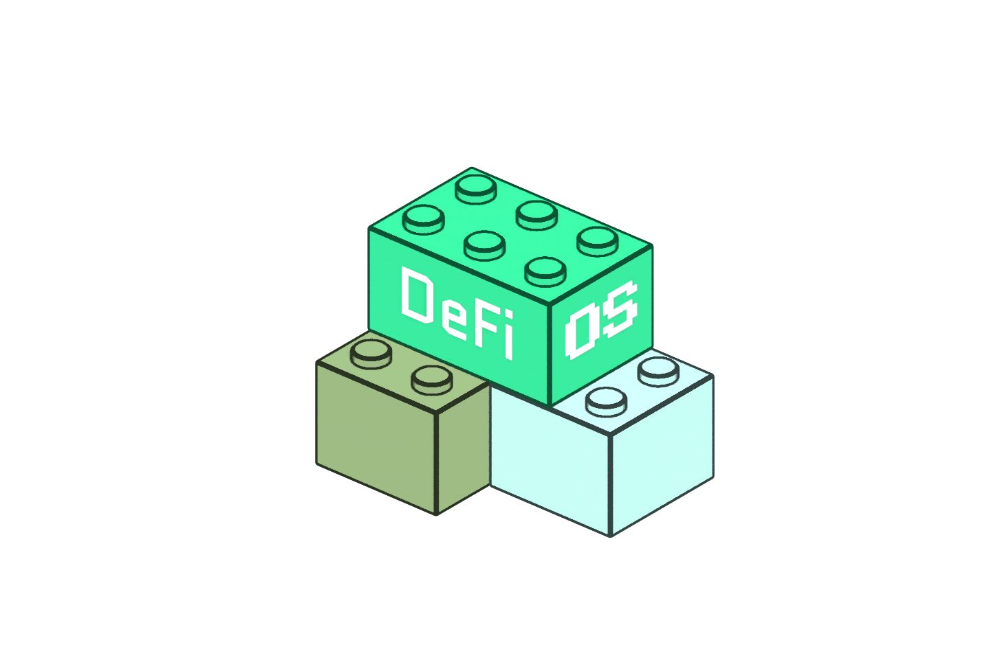

<div align="center">
  
</div>

A self-hosted multi-party wallet. Each machine runs one Node. Nodes form a Group on a headscale tailnet, mint threshold Keys together, and talk to each other and to agents over the COSL, a replicated log.

**Documentation lives in the [wiki](https://github.com/pamacure/defios/wiki)**, with one page per command and concept.

## Requirements

- Go 1.27
- A [headscale](https://github.com/juanfont/headscale) server that both machines can reach, with MagicDNS and the embedded DERP relay enabled

On the headscale host, create a user and one preauth key per machine:

```bash
headscale users create defios
headscale users list -o json
headscale preauthkeys create --user <id> --reusable --expiration 24h -o json   # run once per machine
```

## Install

```bash
CGO_ENABLED=0 go build -o ~/.local/bin/defios ./cmd/defios
```

Build the binary on each machine, or build once and copy it over. Make sure `~/.local/bin` is on `PATH`.

## Quick start

These steps set up two machines, A and B, as a 2-of-2 wallet. On each one, run `defios serve` in one terminal and every other command in a second terminal.

**1. Create a Node on each machine** (init takes a few minutes):

```bash
defios init --name laptop                                   # a different name per machine
defios group new personal --headscale https://headscale.example
defios secret set TS_AUTHKEY                                # paste this machine's preauth key
defios serve                                                # leave running
```

**2. Form a Group.** Find the other Node with `defios node list`. Then, on A:

```bash
defios group create <A-node-id> <B-node-id>
```

On B, accept the proposal:

```bash
defios group accept <group-id>
```

`defios group inspect` on either machine should show `valid`.

**3. Mint a Key.** On A:

```bash
defios session start --curve ecdsa --t 2
```

On B, accept it:

```bash
defios session accept <session-id>
```

`defios key list` shows the Key on both machines. Add `--alias cold` to `session start` to name it on both; after that each machine's alias is its own, changed with `defios key alias`.

**4. Back up** each machine now, and again after every new Key:

```bash
defios backup ~/defios-$(date +%F).backup
```

**5. Talk:**

```bash
defios conversation send "hello group"
defios conversation log
```

## Minimal example: an agent and a signature

```bash
# An agent on Anthropic's API, answering in Group talk
defios provider add anthropic --api-key '$ANTHROPIC_API_KEY'
defios secret set ANTHROPIC_API_KEY
defios agent add auditor --provider anthropic --model claude-opus-5-5
defios agent include auditor
defios conversation send "@auditor, introduce yourself"

# Sign an Ethereum transfer (each machine adds the Network)
defios secret set ETH_RPC
defios network add mainnet --type ethereum --chain-id 1 --rpc-url '$ETH_RPC'
echo '[{"network": "mainnet", "ethereum": {"to": "<base64 20 bytes>", "value": "1000"}}]' \
  | defios sign fill --key ecdsa:<hex> --transactions - > tx.json
defios sign propose --key ecdsa:<hex> --reason "pay the invoice" --transactions tx.json   # on A
defios sign accept <msg-id>                                                               # on B
defios sign broadcast <msg-id>
```

## Learn more

- [Concepts](https://github.com/pamacure/defios/wiki/Concepts): the vocabulary
- [Configuration](https://github.com/pamacure/defios/wiki/Configuration): directories, `config.toml`, environment variables, exit codes
- [Agents](https://github.com/pamacure/defios/wiki/Agent), [Triggers](https://github.com/pamacure/defios/wiki/Triggers), [Signing](https://github.com/pamacure/defios/wiki/Sign)
- [GLOSSARY.md](GLOSSARY.md) and [docs/adr](docs/adr) for design decisions
