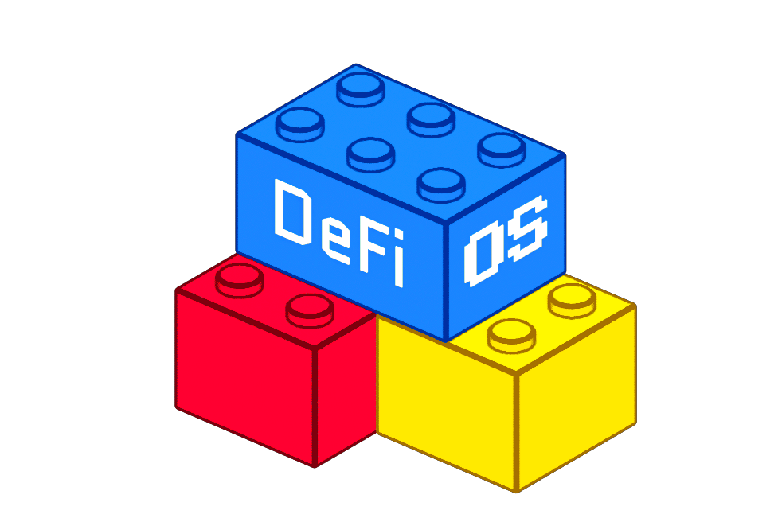

<div align="center">
  
</div>

A self-hosted multi-party wallet. Two machines each run one Node, form a Group on a headscale tailnet, mint threshold Keys together, and talk (with each other and with agents) over the COSL, a replicated log.

## Installation

You need Go 1.27 and a [headscale](https://github.com/juanfont/headscale) server both machines can reach, with MagicDNS and the embedded DERP relay on.

On the headscale host, create a user and one preauth key per machine:

```bash
headscale users create defios
headscale users list -o json
headscale preauthkeys create --user <id> --reusable --expiration 24h -o json   # for machine A
headscale preauthkeys create --user <id> --reusable --expiration 24h -o json   # for machine B
```

## Building

Build a static binary on each machine (or build once and copy it over) and put it on `PATH`:

```bash
CGO_ENABLED=0 go build -o defios ./cmd/defios
```

## Usage

The steps below use two machines, A and B. Run `defios serve` in one terminal and every other command in a second terminal, as the same user.

### 1. Start two Nodes

On each machine, create the Node's identity and passphrase-protected Vault (this takes a few minutes):

```bash
defios init --name laptop      # use a different name on each machine
```

Create a local Group config named `personal` that points at your headscale server:

```bash
defios group new personal --headscale https://headscale.example
```

Store that machine's preauth key in the Group's Vault (paste it at the prompt):

```bash
defios secret set TS_AUTHKEY
```

Bring the Node online, and leave it running:

```bash
defios serve
```

Check it: `defios secret show TS_AUTHKEY` says `vault`, `defios node inspect` prints this Node's ID (note it down) and `defios node usage` shows what it stores on disk.

### 2. Connect them

From the second terminal on each machine, discover the other Node on the tailnet:

```bash
defios node list
```

Check it: each machine lists the other's Node ID, display name and hostname.

### 3. Create a Group

On A, propose a Group of both Nodes:

```bash
defios group create <A-node-id> <B-node-id>
```

On B, accept it using the Group ID A printed:

```bash
defios group accept <group-id>
```

Check it: `defios group list` and `defios group inspect` on both machines show the Group as `valid`, with both Nodes `reachable=yes` and `joined=yes`.

### 4. Create a Key

On A, start a 2-of-2 key generation Session:

```bash
defios session start --curve ecdsa --t 2
```

On B, accept it using the Session ID A printed:

```bash
defios session accept <session-id>
```

Check it: `defios session list` shows the Session complete, and `defios key list` and `defios key inspect ecdsa:<hex>` show the same Key on both machines with `share=yes`.

### 5. Send messages

Post a message to the whole Group:

```bash
defios conversation send "hello group"
```

Post a message in the Key's own Conversation:

```bash
defios conversation send --key ecdsa:<hex> "about this key"
```

Check it: `defios conversation log` (Group talk) and `defios conversation log --key ecdsa:<hex>` (the Key's talk) show the same messages on both machines, and `defios cosl log` shows every row on the log.

A message is on the log once a majority of the Group commits it, so with two machines both must be up. If the other machine's `serve` is down, a send prints `queued` with its msg id and exits with code `5`: the message waits in this machine's Outbox, and `serve` commits it as soon as the other machine is back, in the order this machine wrote it, even across a restart. While anything is queued, later sends queue behind it. Until then it is not on the log: `cosl log` and `sign list` don't show it, while `conversation log` shows it last, marked `queued` with no seq (`"queued": true` under `--json`). Talk, `sign propose`, `sign accept` and `sign broadcast`'s receipts queue this way; a queued Sign Request whose deadline passes is dropped unsent: for one with a Solana transaction that is 60 seconds by default, about as long as its `recent_blockhash` lives, so the other machine must be back within it. A longer `--deadline` does not help: the cluster refuses a stale blockhash, so the request would be signed but never land.

`defios outbox list` shows what is queued, in the order it will commit: each message's msg id, time, type, Conversation and, for a Sign Request, its deadline; it reads the Outbox file, so it works with `serve` up or down. `defios outbox drop <msg-id>` (a unique prefix will do) withdraws one queued message. It was never on the log, so it is erased, and nothing else goes with it, not even a queued reply to it; the rest still commit in order. A message that has already committed cannot be dropped: `drop` says so, with its seq. Nor can one that `serve` tried to commit without learning whether it did, since it may yet commit: `drop` says so, and the drain's next attempt settles it.

### 6. Add a Provider

A Provider is an LLM API this Node's agents call: a base URL and an API path. It is this Node's own config, a `[providers.<alias>]` table in the Group's `config.toml`, and is never shared with the Group, so each machine adds its own and its key goes only to the base URL it named. `provider` needs no serve. The `anthropic` preset is Anthropic's Messages API:

```bash
defios provider add anthropic --api-key '$ANTHROPIC_API_KEY'
```

`--api-key` names the Secret that holds the key, as a `$NAME` reference; the key itself is refused, so it never lands in `config.toml`.

The `openai` preset is OpenAI's Responses API:

```bash
defios provider add openai
```

For any other endpoint, give both fields. The path's suffix picks the API shape, `/messages`, `/chat/completions` or `/responses`:

```bash
defios provider add local --base-url http://127.0.0.1:8080 --api-path /v1/chat/completions
```

To reach the same endpoint in another shape, add a second Provider. For example, OpenAI's Chat Completions next to the `openai` preset; both can use the same key:

```bash
defios provider add openai-cc --preset openai --api-path /v1/chat/completions
```

Store the Provider's API key in this Node's Vault (it never replicates):

```bash
defios secret set ANTHROPIC_API_KEY
```

Check it: `defios provider list` shows the Providers this machine has, and `defios secret show ANTHROPIC_API_KEY` says where the key comes from.

`defios provider edit <alias>` changes only what it is given: `--base-url`, `--api-path`, `--api-key` (`--api-key ''` removes it), or `--body`, the base request for every agent on the Provider, a JSON object read as `agent add --body` reads it. `--body` replaces the body whole, and `--body '{}'` clears it.

### 7. Create an agent

Add an agent with the Handle `@auditor`, on the `anthropic` Provider:

```bash
defios agent add auditor --provider anthropic --model claude-opus-5-5 \
  --body '{"stream": true, "max_tokens": 8192}'
```

`--body` is the rest of the request as a JSON object; `--body @body.json` reads it from a file and `--body -` from stdin. `agent add` writes the `[agents.auditor]` table to the Group's `config.toml` and a placeholder system prompt to `~/.config/defios/agents/auditor/SYSTEM.md`, the agent's profile directory. Replace it with the agent's own:

```bash
echo "You review proposed transactions and point out anything risky." \
  > ~/.config/defios/agents/auditor/SYSTEM.md
```

The profile directory is named by the Handle, so every Group on this machine that defines `@auditor` shares its prompt; each Group's `config.toml` still gives it its own Provider and body.

An agent answers only where it is included. Include it in Group talk:

```bash
defios agent include auditor
```

It prints the Handles now mentionable there. `~/.config/defios/group/personal/config.toml` then reads:

```toml
[agent]
profiles = ["auditor"]

[agents.auditor]
provider = "anthropic"

[agents.auditor.body]
model = "claude-opus-5-5"
stream = true
max_tokens = 8192

[providers.anthropic]
base_url = "https://api.anthropic.com"
api_path = "/v1/messages"
api_key = "$ANTHROPIC_API_KEY"
```

Check it: `defios agent list` shows each agent with its Provider and model, and marks the included ones; `--key <key>` asks about that Key's Conversation instead. `defios agent show auditor` shows every field and the profile directory.

`defios agent include auditor --key ecdsa:<hex>` includes it in that Key's Conversation instead, writing the Conversation's own `config.toml`. A Conversation with no `profiles` of its own follows the Group's list; including one there gives it a list of that Handle alone, and it no longer follows the Group's until you delete its `profiles` line. `defios agent exclude auditor` takes it out again, with `--key` from a Conversation that has its own list; excluding the last leaves `profiles = []`, where no agent answers.

`defios agent edit auditor` changes only what it is given: `--provider`, `--max-turns`, `--model`, or `--body`, which replaces the body whole. `defios agent remove auditor` deletes its table and takes `@auditor` out of the Group's `[agent] profiles` and every Conversation's, keeping its profile directory. `defios agent delete auditor` also deletes the directory, and refuses while another Group on this machine defines `@auditor`.

The `body` table is the rest of the request, in the API's own field names: DeFiOS writes only the conversation and the `say` tool, and the body merges over them. Nested tables become nested JSON, so `[agents.auditor.body.thinking]` with `type = "adaptive"` sends `"thinking": {"type": "adaptive"}`. A local server with no key needs no `api_key`.

Fields that every agent on a Provider shares can go in the Provider's own `body` instead. A profile's body merges over its Provider's body, so an agent with no body of its own runs on the Provider's, and one that sets a field overrides only that field. Here both agents stream, and `@auditor` uses a larger model:

```toml
[providers.anthropic]
base_url = "https://api.anthropic.com"
api_path = "/v1/messages"
api_key = "$ANTHROPIC_API_KEY"

[providers.anthropic.body]
model = "claude-sonnet-5-5"
stream = true
max_tokens = 8192

[agents.scribe]
provider = "anthropic"

[agents.auditor]
provider = "anthropic"

[agents.auditor.body]
model = "claude-opus-5-5"
```

A Conversation's own `config.toml` can override a `[providers.<alias>]` table key by key: one that sets only `base_url` keeps the Group's `api_path`, `api_key` and body, and its own `[providers.<alias>.body]` merges over the Group's.

An agent on the `openai` preset takes the Responses API's own fields:

```toml
[agents.auditor]
provider = "openai"

[agents.auditor.body]
model = "gpt-5"
stream = true
max_output_tokens = 8192
store = false
include = ["reasoning.encrypted_content"]

[agents.auditor.body.reasoning]
effort = "medium"

[providers.openai]
base_url = "https://api.openai.com"
api_path = "/v1/responses"
api_key = "$OPENAI_API_KEY"
```

Each call resends the whole conversation, and the model's reasoning from earlier calls of the same turn goes back with it. With `store = false`, OpenAI keeps nothing, so ask for `reasoning.encrypted_content` to carry that reasoning across calls.

`stream = true` shows the agent's reply as it is written. Without it, the API sends the reply whole and it shows all at once when the call ends; either way the Transcript is the same.

A streamed Chat Completions call (a Provider whose API path ends in `/chat/completions`) reports token usage only when the body asks for it; without this, the Transcript records no usage for its calls:

```toml
[agents.auditor.body.stream_options]
include_usage = true
```

Mention the agent to have it answer:

```bash
defios conversation send "@auditor, introduce yourself"
```

Check it: `send` prints `@auditor: ...` when the agent replies, and `defios conversation log` shows the reply on both machines.

This machine's agents answer what it has written even before the log has it: a message that mentions agents starts its chain when it is sent, committed or queued, and each reply is read by the next agent at once. With the other machine down, a whole chain runs and its replies queue; nothing runs again when they commit.

A chain of agents is named by the msg id `send` printed for the message that started it; any unique prefix of it will do. Ctrl-C cancels the chain an attached `send` is following. From another terminal, `defios conversation cancel` stops the chain that is running, and `defios conversation cancel <msg-id>` stops that one, running or queued. If an agent fails, is cancelled, or `serve` stops partway, `defios conversation retry` reruns the latest such chain, or `--chain <msg-id>` names one. Agents that already replied or stayed silent are not run again. Each chain's Transcript, everything its agents generated, is `transcripts/<msg-id>.jsonl` in the Conversation's data directory; `defios conversation transcript <msg-id>` prints it, step by step, with or without `serve` running (`--json` for its lines as stored).

An agent reads all the talk this machine holds. To keep a long Conversation short for this machine's agents, write a Recap: this machine's own account of the talk up to a seq, which they read in its place.

```bash
defios conversation recap --base-seq <seq> --text "<what was said up to it>"
```

It is `RECAP.md` in the Conversation's data directory on this machine only; nothing reaches the other one. Writing a Recap replaces the last. `defios conversation log --lean` prints what this machine's agents read.

To drop old talk from this machine, prune it. Pruning destroys the text of the talk at or below a seq, or older than an age, on this machine only. The log still verifies, and the other machine keeps its copy:

```bash
defios conversation prune --before <seq>
defios conversation prune --older-than 30d
```

To prune on a schedule, set `prune` at the top of the Group's `config.toml` to an age: whole days like `"90d"`, or a Go duration like `"36h"`. `serve` then prunes every Conversation on start, after a snapshot restore, and once a day. Leave it out on a machine that keeps everything. A restore can bring pruned talk back, so a manual prune warns when no `prune` is set. Either way, pruning warns when it destroys talk your Recap doesn't cover, since this machine's agents then lose it.

### 8. Sign a transaction

A Network is one machine's own: a chain it is willing to sign for, and the endpoints it reaches that chain by. On each machine, add one to the Group's `config.toml`:

```bash
defios secret set ETH_RPC
defios network add mainnet --type ethereum --chain-id 1 --rpc-url '$ETH_RPC'
```

The Secret holds the endpoint's full URL, with its API key or `user:pass@`. An endpoint that needs no credential can be a plain `--rpc-url https://...`; a plain URL with userinfo or a query is refused. The two machines may give the chain different aliases: a Sign Request names the chain (`ethereum chain 1`), never an alias.

On A, propose that the Key sign a transaction, written to `tx.json` as:

```json
[{"network": "mainnet",
  "ethereum": {"to": "<base64 20 bytes>", "value": "1000", "nonce": "0", "gasLimit": "21000",
               "maxFeePerGas": "30000000000", "maxPriorityFeePerGas": "1"}}]
```

```bash
defios sign propose --key ecdsa:<hex> --reason "pay the invoice" --transactions tx.json
```

On B, accept it using the msg id A printed. A machine with no Network for the request's chain refuses to accept:

```bash
defios sign accept <msg-id>
```

Once it is signed, either machine broadcasts it through its own endpoints, each checked first to serve the request's chain:

```bash
defios sign broadcast <msg-id>
```

Check it: `defios sign inspect <msg-id>` shows each transaction's chain and Digest on both machines, and the receipt once it is broadcast.
