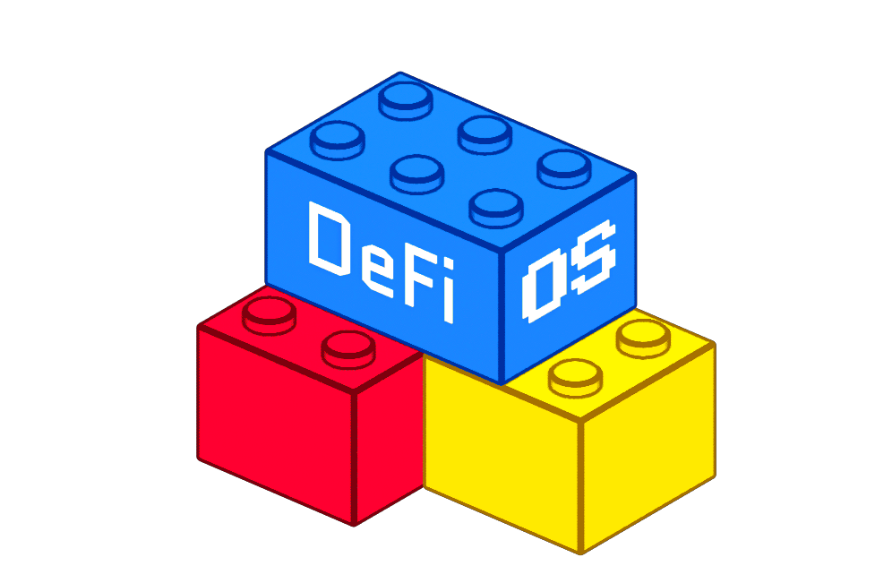

<div align="center">
  
</div>

A self-hosted multi-party wallet. Two machines each run one Node, form a Group on a headscale tailnet, and mint a 2-of-2 ECDSA Key and a 2-of-2 Ed25519 Key. Talk between them is carried on the COSL.

`serve` is the Node online: the Vault stays unlocked, the Node is on the tailnet, and Raft is running. Quit `serve` and the Node stops sending and receiving. The COSL replica stays on disk at the last applied row. Reads of that replica (`node inspect`, `node usage`, `group list`, `group inspect`, `session list`, `session inspect`, `key list`, `key inspect`, `conversation log`, `cosl log`, `cosl decode`) and `conversation prune` still work. Anything that appends, forms a Group, or runs a Session needs `serve`.

Run `serve` in one terminal and the other commands in a second terminal, as the same user. The local socket is mode `0600`.

Files land in `$XDG_CONFIG_HOME/defios` and `$XDG_DATA_HOME/defios` (`~/.config/defios` and `~/.local/share/defios` when those variables are unset). The socket is `$XDG_RUNTIME_DIR/defios/serve.sock`.

## Usage

Call the two machines A and B. Use a different `--name` on each. Leave `group new --hostname` unset; the default is `defios-`, the first 8 hex characters of the Node ID, and the Group alias (e.g. `defios-1a2b3c4d-personal`), so one device presents a distinct hostname on each Group's tailnet.

### 1. Headscale

Both machines join one stock headscale. MagicDNS is on, the embedded DERP relay is on, and the policy lets the two Nodes reach each other (an empty policy allows all). Both machines must reach the same `server_url`. This flow was exercised against headscale 0.29.5.

On the headscale host, create a user and one preauth key per machine:

```bash
headscale users create defios
headscale users list -o json
headscale preauthkeys create --user <id> --reusable --expiration 24h -o json
headscale preauthkeys create --user <id> --reusable --expiration 24h -o json
```

Give A the first key and B the second. When `headscale_url` is plain `http`, start both serves with `TS_DEBUG_USE_DERP_HTTP=1` so the embedded DERP region is dialed over HTTP.

### 2. Build

Go 1.27. On each machine, from a checkout:

```bash
CGO_ENABLED=0 go build -o defios ./cmd/defios
```

That binary is static. Copy it to the other machine when `GOARCH` matches, and put `defios` on `PATH`.

### 3. Init

`init` sets up the device only — identity and Vault — and generates ECDSA preparams before it returns. Stderr prints `generating ECDSA preparams`. That step is CPU-heavy and can take several minutes. Run it on both machines.

```bash
defios init --name laptop
```

The passphrase is prompted twice and must be non-empty. `DEFIOS_PASSPHRASE` or `--passphrase-file` skips the prompt. `serve` must unlock the Vault with that same passphrase. `--name` is the default display name Groups inherit.

Then scaffold a Group under a local alias and point it at the headscale control URL. This creates the Group's config and makes it the Current Group that `serve` and read verbs default to:

```bash
defios group new personal --headscale https://headscale.example
```

The alias (`personal` here) is local to this machine, must match `[a-z0-9][a-z0-9_-]{0,63}`, and never travels on the wire. A Node may hold any number of Groups, each on its own tailnet and with its own isolated state; `group new` focuses the one it creates. Switch the Current Group later with `defios group use <alias>` — it takes effect on the next `serve`, so a running `serve` keeps serving the Group it started on. `defios group list` shows every Group's alias, status, Group ID, and which is current (`*`).

Read verbs (`group inspect`, `node usage`, `cosl log`, `conversation log`, `key list`, `key inspect`) accept `--group <alias>` to read any Group off disk regardless of which is current or served — all non-secret state is plaintext, and a Key's `share=yes` comes from that Group's own encrypted shares over the passphrase.

```bash
defios node inspect
```

Record each Node ID. `group create` needs both.

`defios node usage` prints what this Node takes up on the machine: the binary, `identity` and the Vault, and each Group's COSL (with row and pruned-row counts), Raft, tsnet, Vault files and Workspace, with data, config and grand totals. While `serve` runs it adds serve's PID, uptime, CPU time, RSS, Go heap and goroutines; otherwise it says `serve not running`. It is a one-shot snapshot; use `top` or your OS's monitor for a live view.

### 4. Serve

On each machine, in the terminal that stays open:

```bash
export TS_AUTHKEY='<preauth key for this machine>'
defios serve
```

The Group's `config.toml` says `tailnet_auth_key = "$TS_AUTHKEY"`: a reference to a Secret, found in the environment or else in the Group's Vault. To keep the key out of the environment, run `defios secret set TS_AUTHKEY` (value on stdin) before the first `serve` instead. A config never holds a secret itself: RPC URLs under `[networks.<alias>]` and `api_key` under `[providers.<provider>]` are `"$NAME"` references too.

`serve` prompts for the passphrase once unless `DEFIOS_PASSPHRASE` or `--passphrase-file` is set. It serves the Current Group. One Node has one socket, so only one Group is live at a time: a second `serve` — for any Group — exits 2 with an "already running" message while the first keeps running. The first successful join stores that Group's tailnet state under its subtree; later serves reuse it.

From the other terminal on each machine:

```bash
defios node list
```

Each side prints the other Node's ID, display name, and hostname. Form the Group after that.

### 5. Group

On A, pass exactly two Node IDs, including A's own. A's create is A's accept.

```bash
defios group create <A-node-id> <B-node-id>
```

On B:

```bash
defios group accept <group-id>
```

B prints `Group <id> is valid`. Then on both:

```bash
defios group list
defios group inspect
```

Status is `valid`, the Group ID matches, and both Roster rows show `reachable=yes` and `joined=yes`. `joined` is that Node's `membership.join` on the COSL. If it is still `no`, wait and inspect again. A `not delivered` error means re-run the command once `node list` shows the other Node.

### 6. Keys

Mint ECDSA, then Ed25519. Only one Session may be open. `session start` is the initiator's local accept. The other Node's `serve` stderr prints `session <id> waiting for accept`. Accept there within 2 minutes. After that the Session aborts, and a new `session start` is a new Session ID.

On A:

```bash
defios session start --curve ecdsa --t 2
```

On B, using the printed Session ID:

```bash
defios session accept <session-id>
```

When the rounds finish, on both:

```bash
defios session list
defios session inspect <session-id>
```

Status is complete, with two completes that agree on curve and public key. Repeat with `--curve eddsa --t 2` only after the ECDSA Session is complete.

While `serve` is up:

```bash
defios key list
defios key inspect ecdsa:<hex-from-key-list>
defios key inspect eddsa:<hex-from-key-list>
```

Both machines show the same two `curve:hex` lines, `t=2 n=2`, and `share=yes`. `share=yes` is read from the unlocked Vault. Record each `conversation` line from `key inspect`.

### 7. Conversation

Group-level, from either machine:

```bash
defios conversation send "hello group"
defios conversation log
```

Both machines show the same lines. The human line is `<seq> <time> <display name> <writer>  <text>`, where the writer is `user` for a person's message and `@handle` for an agent's. `--json` prints one JSON object per row, one row per line ([ADR 0017](docs/adr/0017-log-readers-print-jsonl.md)), giving each its `handle` (`""` for a person) and `depth` (0 for a person). `cosl log --json` prints its rows the same way.

After both Keys exist:

```bash
defios conversation send --key ecdsa:<hex> "about the ecdsa key"
defios conversation send --key eddsa:<hex> "about the eddsa key"
defios conversation log
defios conversation log --key ecdsa:<hex>
defios conversation log --key <ecdsa-conversation-id>
```

`--key` accepts `curve:hex`, a unique hex prefix of the public key, or the full Conversation ID hex. `conversation log` with no `--key` shows Group-level text. `conversation log --key` shows that Key's text. The same filter matches on both machines.

A Recap stands in for a stretch of talk. You supply the text; nothing in the Node writes it:

```bash
defios conversation recap --key ecdsa:<hex> --base-seq <seq-of-a-message> --text "what was said so far"
defios conversation log --key ecdsa:<hex>
```

`--base-seq` must be the seq of a message in that same Conversation, past the base of any earlier Recap. Without `--key` it recaps Group-level talk. `conversation log` then prints the Recap first, as `[recap of <n> messages to seq <base>] <text>`, followed only by the messages after its base. `cosl log` still shows every row.

```bash
defios conversation log --key ecdsa:<hex> --full
defios conversation log --key ecdsa:<hex> --lean
```

`--full` also shows the messages and earlier Recaps that the live Recap supersedes. A message whose payload this Node has pruned shows as `[pruned]` with only its seq, time and sender. `--lean` gives an agent its starting context: one `<display name>: <text>` line per entry (`<display name>/@handle: <text>` for an agent's), the live Recap first, then every message after it. Nothing else is printed, including pruned messages. `--lean --json` prints each entry as one `{sender_display_name, handle, text}` line. Both flags work with `--key` and `--limit`. Under `--full`, `--limit` keeps the latest N rows. Otherwise it keeps the latest N messages after the Recap.

```bash
defios conversation prune --key ecdsa:<hex>
```

`prune` destroys the text of the messages the live Recap covers, on this machine only. Every row, its hash and its place in the chain stay, so the replica still verifies and still replicates. Nothing is appended and the other Node is not told, so the two machines can hold different amounts of talk. Recaps are never pruned. With no Recap it exits 1 and points at `conversation recap`. Running it again prunes nothing new. It does not need `serve`. A later snapshot restore from a Node that kept the messages brings them back, and `prune` prints a warning saying so unless this machine's prune policy is on.

To keep a machine light without running `prune`, set `prune = true` at the top of its Group `config.toml`. `serve` then prunes on startup, whenever a Recap commits and after every snapshot restore, in every Conversation, and logs how many messages it dropped up to which seq. It is off by default, and with it off `serve` never destroys a message. A running `serve` notices a change to it within about a minute, so turning it on or off needs no restart. If the file does not parse, `serve` logs that and keeps the setting it last read. One machine can prune while the other keeps everything: they still agree on the chain and replicate to each other.

```bash
defios cosl log
defios cosl decode <msg-id-of-a-key-scoped-row>
```

That row's `conversation_id` equals the `conversation` line from `key inspect` for that Key. `cosl log` for the whole run includes `membership.join`, `session.start`, `tss.session`, `session.complete`, and `app.freeform`.

An external runner can post an agent's reply. The Handle must be defined in this Group's `config.toml` and included in that Conversation's `[agent] profiles`. Otherwise the send exits 1 and nothing is appended:

```bash
defios conversation send --key ecdsa:<hex> --handle @auditor "looks fine"
defios conversation send --key ecdsa:<hex> --handle @auditor --depth 2 "and so does this"
```

`--depth` defaults to 1, works only with `--handle`, and must be between 1 and `max_depth`. Leaving out `--handle` means the message is a person's. `serve` checks the same rules for any client of its socket.

A person's message that mentions an agent must name a Handle included where it is sent. Otherwise the send exits 1, names the Handle and lists the included ones, and nothing is appended. A mention is `@` and a Handle, case-insensitive, at a word boundary: `@Auditor,` and `@auditor--` mention `auditor`, while `a@b.com` and `@auditoré` are not mentions. Write `\@auditor` to name an agent without summoning it. [ADR 0016](docs/adr/0016-what-a-mention-is.md) gives the full rule, and [`docs/mentions/vectors.json`](docs/mentions/vectors.json) the cases a client should pass:

```bash
defios conversation send --key ecdsa:<hex> "@nobody, take a look"
```

When a mention resolves, this machine's `serve` runs the agent and no other machine does. The agent gets its profile's `SYSTEM.md` and a short preamble from `serve` as its system prompt, and the talk in the `--lean` format as its message. Its Model alias must be on the log (`model add`). The key is the Conversation's `[providers.<provider>] api_key`, and it is sent only to this machine's own `base_url` or to the provider's default. An agent may think and write as much as it needs, but only what it passes to its one tool, `say`, is posted: one message of at most 4096 bytes, committed from that Handle at depth 1, and the agent's turn ends there. A longer or empty `say` is refused and the agent may try again. An agent that ends its turn without `say` stays silent: nothing commits and the chain goes on. Each model call may generate up to `max_tokens` tokens (default 8192), and an agent gets at most `max_turns` calls (default 8); running out of either is an error that commits nothing. `send` stays attached and prints each agent's message as `@handle: <text>` as it commits, with skips, silences and errors, until the chain ends; it does not print what the agents generate on the way (`conversation follow` does). The agents a message mentions run one at a time, in mention order, and each sees the messages before it. An agent's message at depth *d* summons the agents it mentions at depth *d*+1 while *d* is below `[agent] max_depth` (default 1, so agents summon none), depth-first: if you write `@a @b` and `@a` mentions `@c`, they answer a, c, b. The preamble tells each agent its depth and the Handles it may summon. A silent agent summons nobody. A mention in a message that cannot summon (unknown, not included, or at `max_depth`) is skipped and shown with the reason, and the message still commits. An agent mentioning itself is ignored. A mention sent while another chain is running in that Conversation waits for it. Rate limits, overload, 5xx responses and dropped connections are retried up to 3 times. Any other error stops the chain, commits nothing for that agent and exits 2. Ctrl-C cancels the chain: nothing is committed for the agent that was answering, the rest are dropped, and your message stays. Everything each agent generated, every request as sent (never the key), and how each agent ended (`said`, `silent`, `error` or `cancelled`) is written to a Transcript on this machine only, one JSONL file per chain at `<data>/group/<alias>/transcripts/<conversation>/<seq>.jsonl`, where `<conversation>` is the hex Conversation ID or `group` and `<seq>` is your message's. Transcripts are plaintext, outside the Vault, never replicated, and survive a replica wipe, a restore and Pruning. `--detach` returns once your message commits:

```bash
defios conversation send --key ecdsa:<hex> "@auditor, is this transfer sane?"
defios conversation send --detach "@auditor, summarise the day"
```

Each Agent Profile can set its model options in the Group `config.toml` (a Conversation's `config.toml` cannot):

```toml
[agents.auditor]
model = "claude"
max_tokens = 4000   # per model call; default 8192
temperature = 0.2   # left out of the request when unset
max_turns = 8       # model calls per summon; default 8
```

`max_tokens` is sent to Anthropic as `max_tokens` and to OpenAI as `max_completion_tokens`. `max_tokens` and `max_turns` must be positive integers and `temperature` a non-negative number, or the config does not load. A value the provider refuses, such as a `max_tokens` over the model's output cap or a `temperature` on a reasoning model, is an error that is not retried.

From another terminal, `conversation follow` watches a Conversation's chains on this machine and keeps following, one chain after another. It streams each agent's whole output as it is generated, a line per kind, `@handle (thinking): ...`, `@handle (text): ...` and `@handle (tool): say {...}` (thinking and tool calls dimmed), then its message as `@handle: <text>` when it commits. Started mid-chain, it shows the agent answering now, its output so far, then the rest. Ctrl-C only detaches it: the chain keeps running and its messages still commit. `--json` prints the raw events. `conversation cancel` cancels the running chain and says whether one was running. An attached `send` reports the cancel and exits 2:

```bash
defios conversation follow --key ecdsa:<hex>
defios conversation cancel --key ecdsa:<hex>
```

`conversation retry` reruns a chain that failed, was cancelled or was cut off by a stop. Without `--chain` it takes the latest such chain in that Conversation, as its Transcripts show; `--chain <seq>` names one by your message's seq. It walks the chain as it first ran: an agent that said something or stayed silent is not run again (shown as skipped), and the agents its message summoned are walked as before, so nothing is posted twice. Every other agent runs again against the talk as it is now, recorded as a new `attempt` in the same Transcript. Retrying a chain that is running or queued is refused (exit 1), and a chain where every agent said or stayed silent has nothing to retry, which it says. Retry posts nothing itself; it queues and streams like `send`, Ctrl-C cancels it, and `--detach` returns once it is queued.

A chain running or queued when `serve` stops (switching the Current Group and a restore count as a stop) is lost and never resumes on its own; a detached sender learns of it only from the missing reply. Recover it after `serve` is back with `conversation retry`, or with `--chain <seq>` for one that was still queued and so has no Transcript, which runs it from the start:

```bash
defios conversation retry --key ecdsa:<hex>
defios conversation retry --chain 42
```

Other clients use the same endpoints on the socket: `GET /v1/conversation/stream` (newline-delimited JSON events), `POST /v1/conversation/cancel` and `POST /v1/conversation/retry` (`{"conversation_id", "chain"}`, answering `{"chain"}` once it is queued), as [ADR 0015](docs/adr/0015-agent-profiles-handles-and-agent-chains.md) describes, amended by [ADR 0018](docs/adr/0018-an-agent-says-one-message.md): every event names its `chain` (the seq of the message that started it); `chain.start`; `agent.start {handle, depth}`; `agent.delta {kind, text}` for every block of output as it is generated, with `kind` `thinking`, `text` or `tool` (a tool call, `say` included, streams as its name and its JSON input; a new block of the same kind, other than text, starts with a newline); `agent.reset` when a retry starts the current model call over, voiding that call's deltas; `agent.commit {seq, text}` with the message once it commits; `agent.silent {handle}` for an agent that ended without `say`; `agent.skipped {handle, reason}`; `agent.error {handle, error}`; and `chain.end` (with `cancelled`, or `error` when the serve stopped). A watcher joining mid-chain first gets the chain's `chain.start`, the running agent's `agent.start` and its output so far as one `agent.delta` per run of a kind.

An unknown Key exits 1:

```bash
defios conversation log --key ff
defios conversation send --key ff "nope"
```

### 8. Sign and broadcast on Linea Sepolia

Send a native-token transfer on Linea Sepolia (chain ID 59141) signed by the 2-of-2 ECDSA Key. The Key is a plain Ethereum account, so the chain sees an ordinary transaction. Sign Requests carry a transaction, not an arbitrary message.

On A, register the Network. It replicates to B:

```bash
defios network add linea-sepolia --type ethereum --chain-id 59141 --rpc-url https://rpc.sepolia.linea.build
defios network list
```

On either machine, get the Key's address and fund it from a Linea Sepolia faucet with a little test ETH:

```bash
defios key inspect ecdsa:<hex-from-key-list>
```

The `ethereum_address` line is the account. Check its balance on https://sepolia.lineascan.build/ before going on. The transaction's `nonce` is the account's transaction count, `0` for a fresh account.

On A, write the transaction. `to` is a base64 20-byte address; this converts a hex one (here, send to yourself or any address you control):

```bash
python3 -c "import base64,sys; print(base64.b64encode(bytes.fromhex(sys.argv[1].removeprefix('0x'))).decode())" 0x<recipient-address>
```

Without Python, GNU coreutils works (the hex must be uppercase), as does `xxd`:

```bash
echo <recipient-hex-without-0x> | tr a-f A-F | basenc --base16 -d | base64
echo <recipient-hex-without-0x> | xxd -r -p | base64
```

```bash
cat > tx.json <<'EOF2'
[{"network": "linea-sepolia",
  "ethereum": {"to": "<base64-from-above>", "value": "1000000000000", "nonce": "0",
               "gasLimit": "21000", "maxFeePerGas": "1000000000", "maxPriorityFeePerGas": "100000000"}}]
EOF2
```

`value` is in wei (here 0.000001 ETH). Propose it, which also records A's acceptance. The request stays open for 5 minutes unless you pass `--deadline <seconds>`:

```bash
defios sign propose --key ecdsa:<hex> --reason "linea sepolia test" --transactions tx.json
```

On both machines:

```bash
defios sign list
defios sign inspect <msg-id>
```

Status is `open` with `1/2 accepted`. `inspect` decodes the transaction (network, recipient, value, fee) and shows the digest every Node derived independently. Check that both machines show the same details and digest before accepting. Then on B:

```bash
defios sign accept <msg-id>
```

That is t=2, so the status becomes `waiting`, then `signing` once a signer starts the Session, then `signed` when a signature verifies against the Key. `waiting` can last a while if another Session (such as keygen) is still open. A request left `waiting` past its deadline becomes `expired`. A Session that aborts, for example by `sign decline` or a timeout, makes the request `aborted`; propose a new one to retry. A Node that accepts after two others did gets a `signer-set-full` error, which is not a failure of the request.

Once `sign list` shows `signed`, broadcast from either machine:

```bash
defios sign broadcast <msg-id>
```

It prints the transaction hash and records a receipt on the COSL. Open `https://sepolia.lineascan.build/tx/<hash>` to confirm it was mined, and `sign list` on both machines shows `broadcasts=1 (fully broadcast)`. Running `sign broadcast` again is harmless.

### 9. Limits

Signing covers Ethereum, Bitcoin and Solana transactions, not arbitrary messages. There is no fee estimation or nonce lookup: set `nonce`, `maxFeePerGas` and the rest yourself.

A 2-Node Group appends only while both Nodes are reachable. With one `serve` stopped, the other cannot commit. The stopped Node's replica stays at the last applied row and resumes when `serve` starts again.

Because only one Group is live at a time, a Group you switch focus away from is offline to its peers until you refocus it: it cannot append, keygen, or receive Conversation messages meanwhile. Refocusing (`group use <other>` then `serve`) reconverges it through Raft catch-up automatically, with no manual resync.
