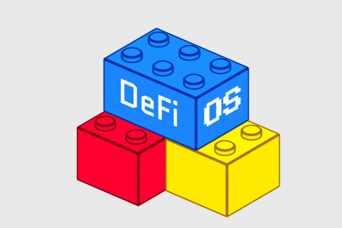

A self-hosted multi-party wallet. Two machines each run one Node, form a Group on a headscale tailnet, and mint a 2-of-2 ECDSA Key and a 2-of-2 Ed25519 Key. Talk between them is carried on the COSL.

`serve` is the Node online: the Vault stays unlocked, the Node is on the tailnet, and Raft is running. Quit `serve` and the Node stops sending and receiving. The COSL replica stays on disk at the last applied row. Reads of that replica (`node inspect`, `group list`, `group inspect`, `session list`, `session inspect`, `key list`, `key inspect`, `conversation log`, `cosl log`, `cosl decode`) still work. Anything that appends, forms a Group, or runs a Session needs `serve`.

Run `serve` in one terminal and the other commands in a second terminal, as the same user. The local socket is mode `0600`.

Files land in `$XDG_CONFIG_HOME/defios` and `$XDG_DATA_HOME/defios` (`~/.config/defios` and `~/.local/share/defios` when those variables are unset). The socket is `$XDG_RUNTIME_DIR/defios/serve.sock`.

## Usage

Call the two machines A and B. Use a different `--name` on each. Leave `--hostname` unset; the default is `defios-` plus the first 8 hex characters of the Node ID.

### 1. Headscale

Both machines join one stock headscale. MagicDNS is on, the embedded DERP relay is on, and the policy lets the two Nodes reach each other (an empty policy allows all). Both machines must reach the same `server_url`. This flow was exercised against headscale 0.29.5.

On the headscale host, create a user and one preauth key per machine:

```bash
headscale users create defios
headscale users list -o json
headscale preauthkeys create --user <id> --reusable --expiration 24h -o json
headscale preauthkeys create --user <id> --reusable --expiration 24h -o json
```

Give A the first key and B the second. When `headscale_url` is plain `http`, start both serves with `TS_DEBUG_USE_DERP_HTTP=1` so the embedded DERP region is dialed over HTTP.

### 2. Build

Go 1.27. On each machine, from a checkout:

```bash
CGO_ENABLED=0 go build -o defios ./cmd/defios
```

That binary is static. Copy it to the other machine when `GOARCH` matches, and put `defios` on `PATH`.

### 3. Init

`init` sets up the device only — identity and Vault — and generates ECDSA preparams before it returns. Stderr prints `generating ECDSA preparams`. That step is CPU-heavy and can take several minutes. Run it on both machines.

```bash
defios init --name laptop
```

The passphrase is prompted twice and must be non-empty. `DEFIOS_PASSPHRASE` or `--passphrase-file` skips the prompt. `serve` must unlock the Vault with that same passphrase. `--name` is the default display name Groups inherit.

Then scaffold a Group under a local alias and point it at the headscale control URL. This creates the Group's config and makes it the Current Group that `serve` and read verbs default to:

```bash
defios group new personal --headscale https://headscale.example
```

The alias (`personal` here) is local to this machine, must match `[a-z0-9][a-z0-9_-]{0,63}`, and never travels on the wire. Switch the Current Group later with `defios group use <alias>`.

```bash
defios node inspect
```

Record each Node ID. `group create` needs both.

### 4. Serve

On each machine, in the terminal that stays open:

```bash
export TS_AUTHKEY='<preauth key for this machine>'
defios serve
```

`serve` prompts for the passphrase once unless `DEFIOS_PASSPHRASE` or `--passphrase-file` is set. A second `serve` for the same Node exits 2. The first successful join stores tailnet state under the data directory; later serves reuse it.

From the other terminal on each machine:

```bash
defios node list
```

Each side prints the other Node's ID, display name, and hostname. Form the Group after that.

### 5. Group

On A, pass exactly two Node IDs, including A's own. A's create is A's accept.

```bash
defios group create <A-node-id> <B-node-id>
```

On B:

```bash
defios group accept <group-id>
```

B prints `Group <id> is valid`. Then on both:

```bash
defios group list
defios group inspect
```

Status is `valid`, the Group ID matches, and both Roster rows show `reachable=yes` and `joined=yes`. `joined` is that Node's `membership.join` on the COSL. If it is still `no`, wait and inspect again. A `not delivered` error means re-run the command once `node list` shows the other Node.

### 6. Keys

Mint ECDSA, then Ed25519. Only one Session may be open. `session start` is the initiator's local accept. The other Node's `serve` stderr prints `session <id> waiting for accept`. Accept there within 2 minutes. After that the Session aborts, and a new `session start` is a new Session ID.

On A:

```bash
defios session start --curve ecdsa --t 2
```

On B, using the printed Session ID:

```bash
defios session accept <session-id>
```

When the rounds finish, on both:

```bash
defios session list
defios session inspect <session-id>
```

Status is complete, with two completes that agree on curve and public key. Repeat with `--curve eddsa --t 2` only after the ECDSA Session is complete.

While `serve` is up:

```bash
defios key list
defios key inspect ecdsa:<hex-from-key-list>
defios key inspect eddsa:<hex-from-key-list>
```

Both machines show the same two `curve:hex` lines, `t=2 n=2`, and `share=yes`. `share=yes` is read from the unlocked Vault. Record each `conversation` line from `key inspect`.

### 7. Conversation

Group-level, from either machine:

```bash
defios conversation send "hello group"
defios conversation log
```

Both machines show the same lines. The human line is `<seq> <time> <display name>  <text>`.

After both Keys exist:

```bash
defios conversation send --key ecdsa:<hex> "about the ecdsa key"
defios conversation send --key eddsa:<hex> "about the eddsa key"
defios conversation log
defios conversation log --key ecdsa:<hex>
defios conversation log --key <ecdsa-conversation-id>
```

`--key` accepts `curve:hex`, a unique hex prefix of the public key, or the full Conversation ID hex. `conversation log` with no `--key` shows Group-level text. `conversation log --key` shows that Key's text. The same filter matches on both machines.

```bash
defios cosl log
defios cosl decode <msg-id-of-a-key-scoped-row>
```

That row's `conversation_id` equals the `conversation` line from `key inspect` for that Key. `cosl log` for the whole run includes `membership.join`, `session.start`, `tss.session`, `session.complete`, and `app.freeform`.

An unknown Key exits 1:

```bash
defios conversation log --key ff
defios conversation send --key ff "nope"
```

### 8. Limits

There is no threshold signing and no chain integration.

A 2-Node Group appends only while both Nodes are reachable. With one `serve` stopped, the other cannot commit. The stopped Node's replica stays at the last applied row and resumes when `serve` starts again.
